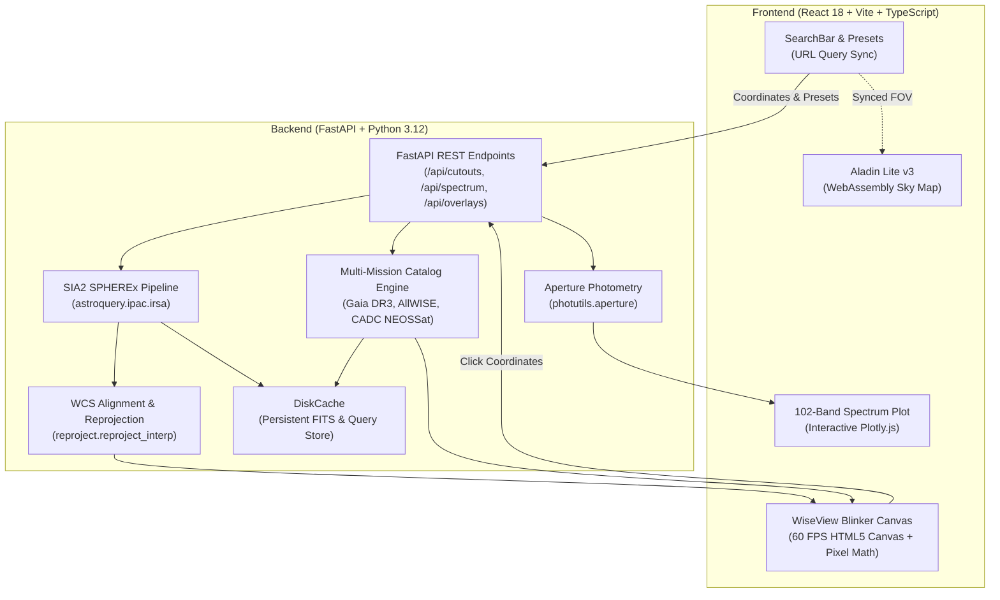

# 🪐 Sol-9: SPHEREx & Planet X Explorer
### Full-Stack Astronomical Web Application for the NASA Space Apps Challenge

[](https://www.spaceappschallenge.org/)
[](#)
[](https://fastapi.tiangolo.com/)
[](https://vitejs.dev/)
[](https://aladin.cds.unistra.fr/AladinLite/)
[](https://irsa.ipac.caltech.edu/Missions/spherex.html)

**Sol-9** is a high-performance astronomical observatory application built for the **NASA Space Apps Challenge: "Planet X and SPHEREx"**. It enables citizen scientists, astrophysicists, and planetary researchers to detect high-proper-motion brown dwarfs, distant Trans-Neptunian Objects (Planet X candidates), and variable stars across NASA's SPHEREx all-sky survey.

---

## 🎯 NASA Space Apps Challenge Overview

### 1. What did we develop?
We developed **Sol-9**, an open-source, full-stack astronomical observatory and citizen science web platform designed to uncover Planet X candidates, ultracool brown dwarfs, and variable stars in NASA’s SPHEREx all-sky survey. Sol-9 features a 60-FPS HTML5 time-series blinking engine inspired by WiseView, an on-the-fly 102-band near-infrared aperture photometry extractor (0.75–5.0 µm) with automated molecular absorption classification, synchronized Aladin Lite v3 WebAssembly sky maps, and multi-mission astrometric overlays.

### 2. How does it address the challenge?
Sol-9 directly implements official NASA Space Apps resources and data workflows:
- **Direct IRSA SIA2 Integration:** Queries NASA/IPAC IRSA Simple Image Access v2 endpoints to retrieve multi-epoch SPHEREx Multi-Extension FITS (MEF) cutouts.
- **Sub-Pixel WCS Reprojection:** Reprojects all epochs onto a common North-up, East-left WCS footprint so background stars stay locked in place while moving objects shift across epochs.
- **Epoch-minus-Reference Difference Imaging:** Computes pixel-by-pixel difference frames (`Epoch_i - Ref_Stack`) to reveal faint moving Planet X candidates and asteroids as distinct black-and-white dipoles.
- **Multi-Mission Validation:** Cross-correlates targets against ESA Gaia DR3 proper-motion vectors, NASA AllWISE (~2010.5) historical baselines, and CSA NEOSSat asteroid cones.
- **102-Band Photometry & Diagnostics:** Performs on-the-fly circular aperture photometry across all 100 active channels to detect diagnostic methane ($\text{CH}_4$), water vapor ($\text{H}_2\text{O}$), and $\text{CO}$ absorption bands.

### 3. Why is it important?
Discovering elusive Trans-Neptunian Objects and cold Y-dwarfs ($T \sim 250\text{ K}$) requires bridging heavy scientific computing with accessible, real-time visualization:
- **Democratizing Petabyte-Scale Science:** Removes the barrier of multi-gigabyte FITS downloads; citizen scientists and researchers can explore and blink the sky directly in their browser.
- **Accelerating Discoveries:** Combines high-speed difference imaging with instant atmospheric spectroscopy to eliminate false positives and confirm moving substellar bodies.
- **Open Collaboration:** Provides a zero-install, URL-synced platform to unite professional astrophysicists and citizen scientists worldwide in solving the mystery of the outer Solar System.

### 👥 Team Members
- **Pratyush Kulshreshtha**
- **Monish Monnat**
- **Akshat Indurakhya**

---

## 🛰️ Official Challenge Resources & Data Sources

This application implements workflows and interfaces directly following the official NASA, ESA, and CSA mission datasets:

1. **NASA/IPAC IRSA SPHEREx Mission Portal:** [irsa.ipac.caltech.edu/Missions/spherex.html](https://irsa.ipac.caltech.edu/Missions/spherex.html)
   - Multi-Extension FITS (MEF) cutouts, Simple Image Access v2 (SIA2) service, and detector array calibrations.
2. **SPHEREx Python Tutorial Notebooks (IRSA):** [caltech-ipac.github.io/irsa-tutorials/spherex/](https://caltech-ipac.github.io/irsa-tutorials/spherex/)
   - SIA2 catalog querying, cutout retrieval, and multi-band spectral extraction routines.
3. **WiseView UX & Blinking Inspiration:** [byw.tools/wiseview](http://byw.tools/wiseview)
   - Smooth 60fps time-series blinking canvas, pan/zoom reticle, and Epoch-minus-Reference difference imaging dipoles.
4. **Gaia Mission Data (MAST/STScI - DR3):** [archive.stsci.edu/missions-and-data/gaia](https://archive.stsci.edu/missions-and-data/gaia)
   - High-precision stellar astrometry, G-band magnitudes, and proper-motion velocity vectors ($\mu_\alpha \cos\delta, \mu_\delta$).
5. **CSA NEOSSat Mission Overview:** [asc-csa.gc.ca/eng/satellites/neossat/](https://www.asc-csa.gc.ca/eng/satellites/neossat/)
   - Canadian Space Agency's Near-Earth Object Surveillance Satellite tracking asteroids and space debris.
6. **Canadian Astronomy Data Centre (CADC):** [cadc-ccda.hia-iha.nrc-cnrc.gc.ca/en/](https://www.cadc-ccda.hia-iha.nrc-cnrc.gc.ca/en/)
   - CADC TAP cone queries retrieving NEOSSat observation footprints and exposure times.
7. **CSA NEOSSat Python Tutorial:** [github.com/asc-csa/NEOSSAT_Tutorial](https://github.com/asc-csa/NEOSSAT_Tutorial)
   - Tutorial workflows for querying NEOSSat archives via `astroquery.cadc`.
8. **CSA NEOSSat Open Dataset:** [data.asc-csa.gc.ca/dataset/neossat](https://data.asc-csa.gc.ca/dataset/neossat)
   - Open government datasets of Canadian Near-Earth Object observations.

---

## 🔭 Key Features & Capabilities

### 1. WiseView-Inspired HTML5 `<canvas>` Blinker
- **Interactive Multi-Epoch Blinking (1–20 FPS):** Fast time-series playback modeled after WiseView with play/pause, timeline scrubber, and frame stepper.
- **Sub-Pixel Pan & Smooth Zoom:** Mouse wheel zoom (0.5× to 8.0×), click-and-drag pan, and auto-reset.
- **Astronomical Reticle & Compass:** Real-time hovered celestial coordinates (RA, Dec in sexagesimal / decimal) and North/East compass orientation widget.
- **Image Math & Display Modes:**
  - `Epoch Sequence`: Flipbook animation across raw observation epochs.
  - `Difference Mode (Epoch - Reference)`: Epoch minus median stack highlighting moving Planet X candidates and asteroids as distinct black-and-white dipoles.
  - `Coadded Stack`: Median-combined master stack for deep SNR detection of ultra-faint candidates.
  - `Detector Array RGB`: False-color composite mapping SPHEREx Short (Bands 1/2), Mid (Bands 3/4), and Long (Bands 5/6) near-IR arrays.
  - `Band 1–6 Single Detector`: Direct inspection of individual detector array coadds.

### 2. Multi-Mission Overlays
- **Gaia DR3 Proper Motion Arrows:** Dynamic vector arrows showing proper motion magnitude and direction over a 20-year baseline.
- **AllWISE Historical Markers (~2010.5):** Historical baseline positions from AllWISE ($W1, W2$) showing displacement against current SPHEREx epochs (2024–2026).
- **CSA NEOSSat Asteroid Footprints:** Overlay Canadian Space Agency NEOSSat asteroid / NEO observation search cones.

### 3. Click-to-Spectrum Photometry (102 SPHEREx Channels)
- Clicking any star or pixel triggers on-the-fly circular aperture photometry (`photutils.aperture.CircularAperture`) across all 100 active SPHEREx spectral channels (0.75–5.0 µm, skipping blank dichroic channels 51 & 52).
- Dark-mode interactive Plotly chart with error bars and shaded molecular absorption bands:
  - **$\text{H}_2\text{O}$ Water Vapor:** 1.15, 1.40, 1.88, 2.70 µm
  - **$\text{CH}_4$ Methane:** 1.66, 2.20, 3.31 µm (key brown dwarf & Planet X diagnostic)
  - **$\text{CO}$ Carbon Monoxide:** 2.32, 4.67 µm
  - **$\text{CO}_2$ Carbon Dioxide:** 4.26 µm
- Automated spectral classification (Cold Y-Dwarf / Substellar Candidate, T-Dwarf Binary, M-Dwarf, T Tauri YSO, Mira Variable).
- **Export Data:** One-click download as scientific CSV or JSON.

### 4. Aladin Lite v3 WebAssembly Context Panel
- Synchronized split panel powered by Aladin Lite v3 WebAssembly (`import A from 'aladin-lite'; await A.init`).
- Switchable multi-wavelength all-sky surveys: DSS2 Color (Optical), 2MASS Color (Near-IR JHK), and AllWISE Color (Mid-IR).

### 5. URL-Synced Exploration & Challenge Target Presets
Every parameter (`ra`, `dec`, `fov`, `stretch`, `mode`, `fps`, `target`) syncs to URL query parameters via `react-router-dom` for instant sharing and embedding.
Includes 5 pre-configured challenge targets:
1. **Barnard's Star:** Ultra-high proper motion red dwarf (10.4 arcsec/yr).
2. **Epsilon Indi B:** Binary brown dwarf system (T1 + T6) with deep methane bands.
3. **WISE 0855-0714:** Coldest known Y-dwarf ($T \sim 250\text{ K}$) and primary Planet X analog.
4. **RW Aurigae:** Classical T Tauri star with circumstellar accretion disk eclipses.
5. **R Draconis:** Mira-type long-period pulsating giant with $>5\text{ mag}$ infrared swings.

---

## 🛠️ Architecture & Tech Stack



---

## 🚀 Quickstart & Setup

### Option 1: Docker (Recommended)
Run the entire full-stack application (pre-configured multi-stage build):

```bash
docker-compose up --build
```

Access the web interface at **`http://localhost:8000`**.

---

### Option 2: Local Development Setup

#### 1. Backend Setup (FastAPI)
```bash
cd backend
python -m venv venv
# On Windows:
.\venv\Scripts\activate
# On Linux/macOS:
source venv/bin/activate

pip install -r requirements.txt
python -m uvicorn main:app --host 127.0.0.1 --port 8000 --reload
```
The FastAPI backend will run at **`http://127.0.0.1:8000`** (Swagger docs available at `http://127.0.0.1:8000/docs`).

#### 2. Frontend Setup (React + Vite)
```bash
cd frontend
npm install
npm run dev
```
The Vite development server will run at **`http://127.0.0.1:5173`**.

---

## 📡 API Reference

| Endpoint | Method | Parameters | Description |
|---|---|---|---|
| `/api/health` | `GET` | - | Health status and connected astronomical missions |
| `/api/presets` | `GET` | - | Returns Challenge target presets with astronomical telemetry |
| `/api/resolve` | `GET` | `name` | Resolves target name or coordinates into decimal degrees |
| `/api/cutouts` | `GET` | `ra, dec, fov, stretch, collection, include_deep` | Returns WCS-aligned epoch frames, difference frames, and band stacks |
| `/api/spectrum` | `POST` | `{ ra, dec, pixel_x, pixel_y, fov, target_name }` | Circular aperture photometry across all 100 SPHEREx near-IR channels |
| `/api/overlays` | `GET` | `ra, dec, fov` | Multi-mission catalog data: Gaia DR3 vectors, AllWISE, and CADC NEOSSat |

---

## 📜 Scientific Attribution & License

Built with data and documentation provided by:
- **NASA / Caltech-IPAC Infrared Science Archive (IRSA)**
- **ESA Gaia Science Archive & Space Telescope Science Institute (STScI)**
- **Canadian Space Agency (CSA) & Canadian Astronomy Data Centre (CADC)**
- **WiseView by Dan Caselden (Backyard Worlds: Planet 9)**

Developed for open science and citizen astronomy under the MIT License.
